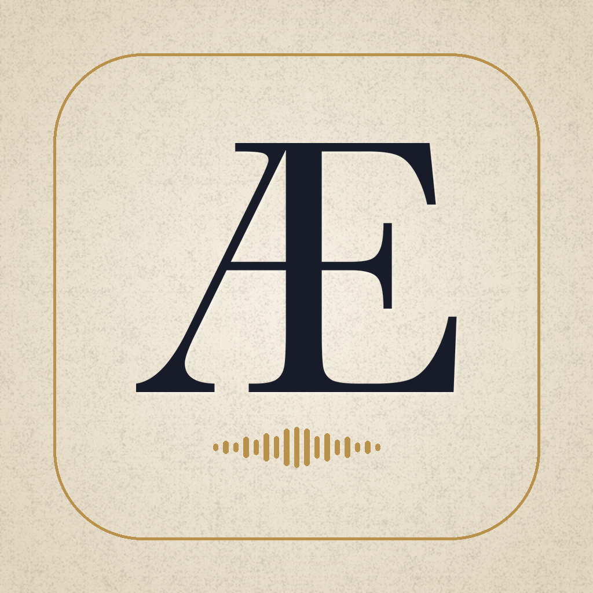

# Ætherna

## Português (Brasil)

Conversas em áudio, geradas por IA, sobre livros, filmes, séries, animes e história. Este repositório não tem o código do app: serve para avisos de atualização, suporte e os documentos legais.

O Ætherna transforma livros, filmes, séries, animes e grandes temas da história em conversas em áudio para você ouvir onde quiser.

Cada obra ganha dois formatos:
• Deep dive: um mergulho guiado, parte por parte, no enredo, nos personagens e no contexto.
• Debate: duas vozes discutindo as ideias, os acertos e as polêmicas da obra.

O QUE VOCÊ ENCONTRA
• Centenas de obras e mais de mil episódios, por categoria: cinema, séries, história, mistérios, crimes, anime e mangá, games e mais.
• Séries agrupadas: anime e mangá, temporadas e partes numa tela só.
• Ordem sem spoiler: o app segue a ordem da obra e avisa quando um episódio está à frente de onde você parou.
• Player completo: velocidade, voltar 15 s e avançar 30 s, timer de sono e controles na tela bloqueada.
• Quatro estilos visuais: Cinemateca, Edição, Sinal e Vidro.
• Interface em português, inglês, alemão e chinês (tradicional e simplificado).

ÆTHERNA PREMIUM
No plano grátis você ouve um episódio por vez. Com o Premium você:
• baixa episódios para ouvir sem internet;
• lê o texto da conversa acompanhando o áudio;
• ouve quantos episódios quiser, sem esperar.

TRANSPARÊNCIA
As conversas são geradas por inteligência artificial e narradas por vozes sintéticas, e cada episódio mostra esses selos. Os episódios são comentários e análises sobre as obras, não a leitura delas. O Ætherna não tem vínculo com autores, editoras ou estúdios.

ASSINATURA
O Ætherna Premium é uma assinatura mensal com renovação automática. O valor é cobrado na sua conta Apple quando você confirma a compra. A assinatura renova sozinha, a menos que seja cancelada pelo menos 24 horas antes do fim do período atual. Gerencie ou cancele nos Ajustes da sua conta Apple.

- [Política de privacidade](https://joaozaokk.github.io/aetherna-app/privacy/pt-BR/)
- [Termos de uso](https://joaozaokk.github.io/aetherna-app/terms/pt-BR/)
- [Novidades](https://joaozaokk.github.io/aetherna-app/changelog/pt-BR/)
- Suporte: Encontrou um problema ou quer sugerir algo? Abra uma issue: https://github.com/JoaoZaokk/aetherna-app/issues/new/choose. Não coloque dados pessoais na issue: ela é pública.

## English

AI-generated audio conversations about books, films, series, anime and history. This repository does not hold the app's code: it is for update notes, support and the legal documents.

Ætherna turns books, films, TV series, anime and the great themes of history into audio conversations you can listen to anywhere.

Every work comes in two formats:
• Deep dive: a guided journey, part by part, through the plot, the characters and the context.
• Debate: two voices discussing the ideas, the highlights and the controversies of the work.

WHAT YOU GET
• Hundreds of works and over a thousand episodes, by category: film, series, history, mysteries, true crime, anime and manga, games and more.
• Grouped series: anime and manga, seasons and parts on a single screen.
• Spoiler-free order: the app follows the work's order and warns you when an episode is ahead of where you stopped.
• A complete player: speed, skip back 15 s and forward 30 s, sleep timer and lock screen controls.
• Four visual styles: Cinematheque, Edition, Signal and Glass.
• Interface in Portuguese, English, German and Chinese (Traditional and Simplified).

ÆTHERNA PREMIUM
On the free plan you listen to one episode at a time. With Premium you:
• download episodes to listen offline;
• read the conversation's text as the audio plays;
• listen to as many episodes as you like, without waiting.

TRANSPARENCY
The conversations are generated by artificial intelligence and narrated by synthetic voices, and every episode shows these labels. Episodes are commentary and analysis about the works, not readings of them. Ætherna is not affiliated with any author, publisher or studio.

SUBSCRIPTION
Ætherna Premium is a monthly auto-renewing subscription. Payment is charged to your Apple Account when you confirm the purchase. The subscription renews automatically unless it is cancelled at least 24 hours before the end of the current period. Manage or cancel it in your Apple Account settings.

- [Privacy Policy](https://joaozaokk.github.io/aetherna-app/privacy/en/)
- [Terms of Use](https://joaozaokk.github.io/aetherna-app/terms/en/)
- [What's new](https://joaozaokk.github.io/aetherna-app/changelog/en/)
- Support: Found a problem or have a suggestion? Open an issue: https://github.com/JoaoZaokk/aetherna-app/issues/new/choose. Do not put personal data in the issue: it is public.

## Deutsch

KI-generierte Audiogespräche über Bücher, Filme, Serien, Anime und Geschichte. Dieses Repository enthält nicht den Code der App: Es dient für Update-Hinweise, Support und die rechtlichen Dokumente.

Ætherna verwandelt Bücher, Filme, Serien, Anime und die großen Themen der Geschichte in Audiogespräche, die du überall hören kannst.

Jedes Werk gibt es in zwei Formaten:
• Deep Dive: eine geführte Reise, Teil für Teil, durch Handlung, Figuren und Hintergrund.
• Debatte: zwei Stimmen diskutieren die Ideen, Stärken und Kontroversen des Werks.

WAS DICH ERWARTET
• Hunderte Werke und über tausend Folgen, nach Kategorien: Film, Serien, Geschichte, Mysterien, True Crime, Anime und Manga, Games und mehr.
• Gruppierte Reihen: Anime und Manga, Staffeln und Teile auf einem Bildschirm.
• Reihenfolge ohne Spoiler: Die App folgt der Reihenfolge des Werks und warnt dich, wenn eine Folge weiter ist als deine Stelle.
• Vollständiger Player: Geschwindigkeit, 15 s zurück und 30 s vor, Schlaftimer und Steuerung auf dem Sperrbildschirm.
• Vier Designs: Kinemathek, Ausgabe, Signal und Glas.
• Oberfläche auf Portugiesisch, Englisch, Deutsch und Chinesisch (traditionell und vereinfacht).

ÆTHERNA PREMIUM
Im kostenlosen Tarif hörst du eine Folge nach der anderen. Mit Premium kannst du:
• Folgen herunterladen und offline hören;
• den Text des Gesprächs mitlesen, während der Ton läuft;
• so viele Folgen hören, wie du willst, ohne zu warten.

TRANSPARENZ
Die Gespräche werden von künstlicher Intelligenz erzeugt und von synthetischen Stimmen gesprochen; jede Folge zeigt diese Kennzeichnung. Die Folgen sind Kommentare und Analysen zu den Werken, keine Lesungen. Ætherna steht in keiner Verbindung zu Autoren, Verlagen oder Studios.

ABONNEMENT
Ætherna Premium ist ein monatliches, sich automatisch verlängerndes Abonnement. Die Zahlung wird bei Bestätigung des Kaufs deinem Apple Account belastet. Das Abo verlängert sich automatisch, sofern es nicht mindestens 24 Stunden vor Ende des laufenden Zeitraums gekündigt wird. Verwalten oder kündigen kannst du es in den Einstellungen deines Apple Accounts.

- [Datenschutzerklärung](https://joaozaokk.github.io/aetherna-app/privacy/de/)
- [Nutzungsbedingungen](https://joaozaokk.github.io/aetherna-app/terms/de/)
- [Neuigkeiten](https://joaozaokk.github.io/aetherna-app/changelog/de/)
- Support: Ein Problem gefunden oder eine Idee? Eröffne ein Issue: https://github.com/JoaoZaokk/aetherna-app/issues/new/choose. Bitte keine persönlichen Daten ins Issue schreiben: Es ist öffentlich.

## 繁體中文（台灣）

由 AI 生成、關於書籍、電影、影集、動畫與歷史的音訊對談。此儲存庫不包含 App 程式碼，僅用於更新公告、支援與法律文件。

Ætherna 把書籍、電影、影集、動畫和歷史上的重大主題，變成可以隨時隨地收聽的音訊對談。

每部作品都有兩種形式：
• 深度解析：逐段導覽劇情、角色與背景。
• 辯論：兩個聲音討論作品的想法、亮點與爭議。

內容特色
• 數百部作品、上千集節目，依類別整理：電影、影集、歷史、懸疑、犯罪、動畫與漫畫、遊戲等。
• 系列整合：動畫與漫畫、各季與各部分，集中在同一個畫面。
• 無劇透順序：依照作品的順序播放，若某集超前你目前的進度會提醒你。
• 完整播放器：播放速度、倒退 15 秒與快轉 30 秒、睡眠定時器及鎖定畫面控制。
• 四種視覺風格：電影資料館、版本、訊號與玻璃。
• 介面支援葡萄牙文、英文、德文與中文（繁體及簡體）。

ÆTHERNA PREMIUM
免費方案一次可收聽一集。升級 Premium 後你可以：
• 下載節目，離線收聽；
• 一邊播放一邊閱讀對談文字；
• 想聽幾集就聽幾集，不必等待。

透明說明
對談內容由人工智慧生成，並由合成語音朗讀，每一集都會標示。節目是對作品的評論與分析，並非作品朗讀。Ætherna 與任何作者、出版社或製作公司均無關聯。

訂閱說明
Ætherna Premium 為按月自動續訂的訂閱。確認購買時會向你的 Apple 帳號收費。除非在目前期間結束前至少 24 小時取消，否則訂閱會自動續訂。你可以在 Apple 帳號設定中管理或取消訂閱。

- [隱私權政策](https://joaozaokk.github.io/aetherna-app/privacy/zh-Hant/)
- [使用條款](https://joaozaokk.github.io/aetherna-app/terms/zh-Hant/)
- [新功能](https://joaozaokk.github.io/aetherna-app/changelog/zh-Hant/)
- 支援: 發現問題或有建議嗎？請開 issue：https://github.com/JoaoZaokk/aetherna-app/issues/new/choose。issue 是公開的，請勿填寫個人資料。

## 简体中文

由 AI 生成、关于书籍、电影、剧集、动画与历史的音频对谈。本仓库不包含 App 代码，仅用于更新公告、支持与法律文件。

Ætherna 把书籍、电影、剧集、动画和历史上的重大主题，变成可以随时随地收听的音频对谈。

每部作品都有两种形式：
• 深度解析：逐段导览剧情、角色与背景。
• 辩论：两个声音讨论作品的思想、亮点与争议。

内容特色
• 数百部作品、上千集节目，按类别整理：电影、剧集、历史、悬疑、犯罪、动画与漫画、游戏等。
• 系列整合：动画与漫画、各季与各部分，集中在同一个页面。
• 无剧透顺序：按照作品的顺序播放，如果某一集超前于你当前的进度会提醒你。
• 完整播放器：播放速度、后退 15 秒与快进 30 秒、睡眠定时器以及锁定屏幕控制。
• 四种视觉风格：电影资料馆、版本、信号与玻璃。
• 界面支持葡萄牙语、英语、德语和中文（繁体及简体）。

ÆTHERNA PREMIUM
免费方案一次可收听一集。升级 Premium 后你可以：
• 下载节目，离线收听；
• 一边播放一边阅读对谈文字；
• 想听几集就听几集，无需等待。

透明说明
对谈内容由人工智能生成，并由合成语音朗读，每一集都会标注。节目是对作品的评论与分析，并非作品朗读。Ætherna 与任何作者、出版社或制作公司均无关联。

订阅说明
Ætherna Premium 为按月自动续订的订阅。确认购买时将从你的 Apple 账户扣款。除非在当前周期结束前至少 24 小时取消，否则订阅将自动续订。你可以在 Apple 账户设置中管理或取消订阅。

- [隐私政策](https://joaozaokk.github.io/aetherna-app/privacy/zh-Hans/)
- [使用条款](https://joaozaokk.github.io/aetherna-app/terms/zh-Hans/)
- [新功能](https://joaozaokk.github.io/aetherna-app/changelog/zh-Hans/)
- 支持: 发现问题或有建议？请提交 issue：https://github.com/JoaoZaokk/aetherna-app/issues/new/choose。issue 是公开的，请勿填写个人信息。
