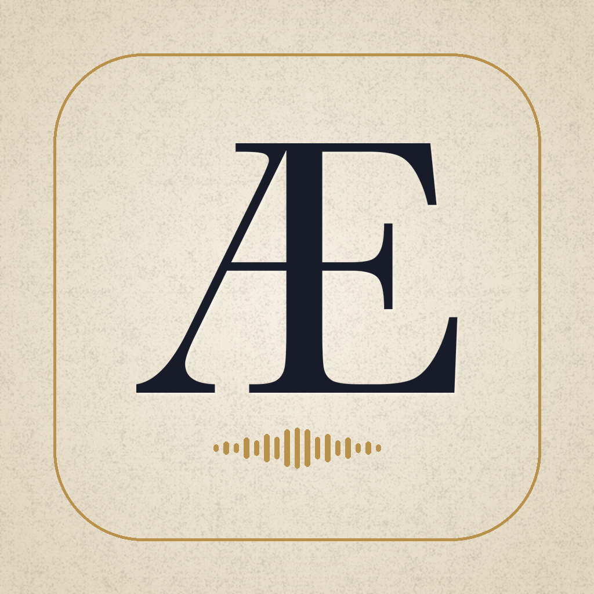

## Português (Brasil)

Conversas em áudio, geradas por IA, sobre livros, filmes, séries, animes e história. Este repositório não tem o código do app: serve para avisos de atualização, suporte e os documentos legais.

O Ætherna transforma livros, filmes, séries, animes e grandes temas da história em conversas em áudio para você ouvir onde quiser.

Cada obra ganha dois formatos:
• Deep dive: um mergulho guiado, parte por parte, no enredo, nos personagens e no contexto.
• Debate: duas vozes discutindo as ideias, os acertos e as polêmicas da obra.

O QUE VOCÊ ENCONTRA
• Centenas de obras e mais de mil episódios, por categoria: cinema, séries, história, mistérios, crimes, anime e mangá, games e mais.
• Séries agrupadas: anime e mangá, temporadas e partes numa tela só.
• Ordem sem spoiler: o app segue a ordem da obra e avisa quando um episódio está à frente de onde você parou.
• Player completo: velocidade, voltar 15 s e avançar 30 s, timer de sono e controles na tela bloqueada.
• Quatro estilos visuais: Cinemateca, Edição, Sinal e Vidro.
• Interface e catálogo em português, inglês e alemão.

ÆTHERNA PREMIUM
No plano grátis você ouve um episódio por vez. Com o Premium você:
• baixa episódios para ouvir sem internet;
• lê o texto da conversa acompanhando o áudio;
• ouve quantos episódios quiser, sem esperar.

TRANSPARÊNCIA
As conversas são geradas por inteligência artificial e narradas por vozes sintéticas, e cada episódio mostra esses selos. Os episódios são comentários e análises sobre as obras, não a leitura delas. O Ætherna não tem vínculo com autores, editoras ou estúdios.

ASSINATURA
O Ætherna Premium é uma assinatura mensal com renovação automática. O valor é cobrado na sua conta Apple quando você confirma a compra. A assinatura renova sozinha, a menos que seja cancelada pelo menos 24 horas antes do fim do período atual. Gerencie ou cancele nos Ajustes da sua conta Apple.

- [Política de privacidade](https://joaozaokk.github.io/aetherna-app/privacy/pt-BR/)
- [Termos de uso](https://joaozaokk.github.io/aetherna-app/terms/pt-BR/)
- [Novidades](https://joaozaokk.github.io/aetherna-app/changelog/pt-BR/)
- Suporte: Encontrou um problema ou quer sugerir algo? Abra uma issue: https://github.com/JoaoZaokk/aetherna-app/issues/new/choose. Não coloque dados pessoais na issue: ela é pública.

## English

AI-generated audio conversations about books, films, series, anime and history. This repository does not hold the app's code: it is for update notes, support and the legal documents.

Ætherna turns books, films, TV series, anime and the great themes of history into audio conversations you can listen to anywhere.

Every work comes in two formats:
• Deep dive: a guided journey, part by part, through the plot, the characters and the context.
• Debate: two voices discussing the ideas, the highlights and the controversies of the work.

WHAT YOU GET
• Hundreds of works and over a thousand episodes, by category: film, series, history, mysteries, true crime, anime and manga, games and more.
• Grouped series: anime and manga, seasons and parts on a single screen.
• Spoiler-free order: the app follows the work's order and warns you when an episode is ahead of where you stopped.
• A complete player: speed, skip back 15 s and forward 30 s, sleep timer and lock screen controls.
• Four visual styles: Cinematheque, Edition, Signal and Glass.
• Interface and catalog in Portuguese, English and German.

ÆTHERNA PREMIUM
On the free plan you listen to one episode at a time. With Premium you:
• download episodes to listen offline;
• read the conversation's text as the audio plays;
• listen to as many episodes as you like, without waiting.

TRANSPARENCY
The conversations are generated by artificial intelligence and narrated by synthetic voices, and every episode shows these labels. Episodes are commentary and analysis about the works, not readings of them. Ætherna is not affiliated with any author, publisher or studio.

SUBSCRIPTION
Ætherna Premium is a monthly auto-renewing subscription. Payment is charged to your Apple Account when you confirm the purchase. The subscription renews automatically unless it is cancelled at least 24 hours before the end of the current period. Manage or cancel it in your Apple Account settings.

- [Privacy Policy](https://joaozaokk.github.io/aetherna-app/privacy/en/)
- [Terms of Use](https://joaozaokk.github.io/aetherna-app/terms/en/)
- [What's new](https://joaozaokk.github.io/aetherna-app/changelog/en/)
- Support: Found a problem or have a suggestion? Open an issue: https://github.com/JoaoZaokk/aetherna-app/issues/new/choose. Do not put personal data in the issue: it is public.

## Deutsch

KI-generierte Audiogespräche über Bücher, Filme, Serien, Anime und Geschichte. Dieses Repository enthält nicht den Code der App: Es dient für Update-Hinweise, Support und die rechtlichen Dokumente.

Ætherna verwandelt Bücher, Filme, Serien, Anime und die großen Themen der Geschichte in Audiogespräche, die du überall hören kannst.

Jedes Werk gibt es in zwei Formaten:
• Deep Dive: eine geführte Reise, Teil für Teil, durch Handlung, Figuren und Hintergrund.
• Debatte: zwei Stimmen diskutieren die Ideen, Stärken und Kontroversen des Werks.

WAS DICH ERWARTET
• Hunderte Werke und über tausend Folgen, nach Kategorien: Film, Serien, Geschichte, Mysterien, True Crime, Anime und Manga, Games und mehr.
• Gruppierte Reihen: Anime und Manga, Staffeln und Teile auf einem Bildschirm.
• Reihenfolge ohne Spoiler: Die App folgt der Reihenfolge des Werks und warnt dich, wenn eine Folge weiter ist als deine Stelle.
• Vollständiger Player: Geschwindigkeit, 15 s zurück und 30 s vor, Schlaftimer und Steuerung auf dem Sperrbildschirm.
• Vier Designs: Kinemathek, Ausgabe, Signal und Glas.
• Oberfläche und Katalog auf Portugiesisch, Englisch und Deutsch.

ÆTHERNA PREMIUM
Im kostenlosen Tarif hörst du eine Folge nach der anderen. Mit Premium kannst du:
• Folgen herunterladen und offline hören;
• den Text des Gesprächs mitlesen, während der Ton läuft;
• so viele Folgen hören, wie du willst, ohne zu warten.

TRANSPARENZ
Die Gespräche werden von künstlicher Intelligenz erzeugt und von synthetischen Stimmen gesprochen; jede Folge zeigt diese Kennzeichnung. Die Folgen sind Kommentare und Analysen zu den Werken, keine Lesungen. Ætherna steht in keiner Verbindung zu Autoren, Verlagen oder Studios.

ABONNEMENT
Ætherna Premium ist ein monatliches, sich automatisch verlängerndes Abonnement. Die Zahlung wird bei Bestätigung des Kaufs deinem Apple Account belastet. Das Abo verlängert sich automatisch, sofern es nicht mindestens 24 Stunden vor Ende des laufenden Zeitraums gekündigt wird. Verwalten oder kündigen kannst du es in den Einstellungen deines Apple Accounts.

- [Datenschutzerklärung](https://joaozaokk.github.io/aetherna-app/privacy/de/)
- [Nutzungsbedingungen](https://joaozaokk.github.io/aetherna-app/terms/de/)
- [Neuigkeiten](https://joaozaokk.github.io/aetherna-app/changelog/de/)
- Support: Ein Problem gefunden oder eine Idee? Eröffne ein Issue: https://github.com/JoaoZaokk/aetherna-app/issues/new/choose. Bitte keine persönlichen Daten ins Issue schreiben: Es ist öffentlich.
